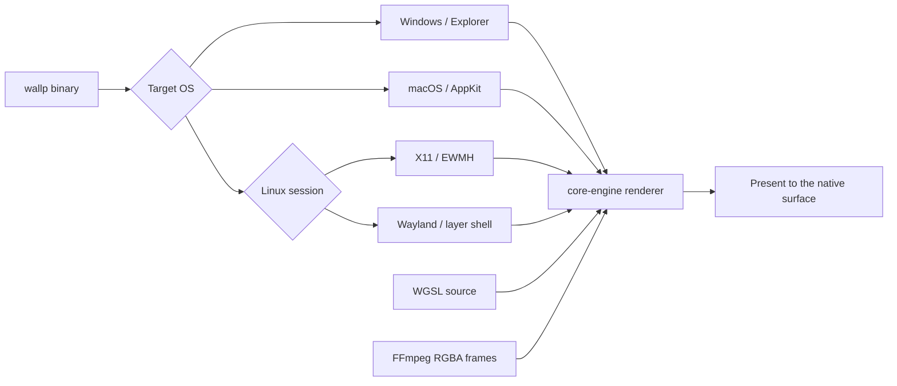
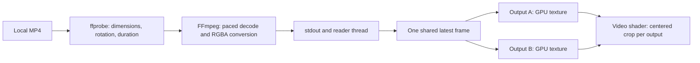
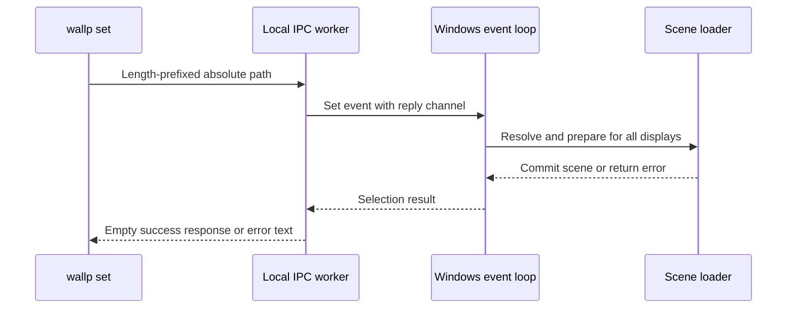

# Desktop Wallpapers architecture

Desktop Wallpapers (`wallp`) is a Rust program that draws to the desktop background of a logged-in session. The native backend puts a surface where desktop icons and ordinary windows can appear above it. The shared renderer takes that surface and paints either a WGSL scene or a looping MP4. Each output can pause independently, while expensive inputs such as video decoding and audio capture are shared across outputs.

This guide describes the engine and its interactive wallpaper packs. The [README](README.md) covers installation, command syntax, and pack examples. The verification table records what shipped in v0.1.0.

- [Workspace and startup](#workspace-and-startup)
- [Native desktop backends](#native-desktop-backends)
- [Rendering and shader inputs](#rendering-and-shader-inputs)
- [Scene selection and hot reload](#scene-selection-and-hot-reload)
- [Textured shader packs and desktop icons](#textured-shader-packs-and-desktop-icons)
- [MP4 playback](#mp4-playback)
- [Audio, cursor, and power](#audio-cursor-and-power)
- [Windows tray and IPC](#windows-tray-and-ipc)
- [Failure handling](#failure-handling)
- [Build, release, and verification](#build-release-and-verification)

## Workspace and startup

| Crate | Responsibility | Start reading here |
| --- | --- | --- |
| `wallp` | Binary entry point, platform dispatch, Unix CLI flags, macOS audio metadata | [main.rs](wallp/src/main.rs), [build.rs](wallp/build.rs) |
| `core-engine` | wgpu renderer, scene resolution and replacement, FFmpeg playback, FFT analysis | [lib.rs](core-engine/src/lib.rs), [shader.rs](core-engine/src/shader.rs), [video.rs](core-engine/src/video.rs), [audio.rs](core-engine/src/audio.rs) |
| `platform-win` | Explorer attachment, monitor and window queries, WASAPI, tray, local IPC | [app.rs](platform-win/src/app.rs), [desktop.rs](platform-win/src/desktop.rs) |
| `platform-mac` | AppKit placement and events, display discovery, IOKit power queries, Core Audio | [lib.rs](platform-mac/src/lib.rs), [screen.rs](platform-mac/src/screen.rs), [audio.rs](platform-mac/src/audio.rs) |
| `platform-linux` | Linux session selection, X11 and Wayland drivers, PulseAudio capture, sysfs power queries | [lib.rs](platform-linux/src/lib.rs), [x11.rs](platform-linux/src/x11.rs), [wayland.rs](platform-linux/src/wayland.rs) |

Cargo chooses the platform crate at compile time. On Linux, the backend then chooses Wayland if `WAYLAND_DISPLAY`, `WAYLAND_SOCKET`, or `XDG_SESSION_TYPE=wayland` indicates a Wayland session. Otherwise it uses X11 when `DISPLAY` is set. A Wayland session without layer-shell support reports an error. With no scene argument, each renderer starts with the built-in WGSL pipeline.

Windows, macOS, and X11 use winit to create windows and dispatch events. Wayland uses Smithay Client Toolkit and a calloop event loop because its wallpaper surface needs a layer-shell role. The shared boundary is the renderer constructor and frame API. A backend supplies a window or a pre-created wgpu surface, owns the output lifecycle, and decides when to call `render_with_inputs`. The core owns the GPU objects and scene data. There is no cross-platform `DesktopSurface` trait in the shipped code.

## Native desktop backends

| Backend | Desktop placement | Per-output pause signal | Output lifecycle |
| --- | --- | --- | --- |
| Windows | Explorer `WorkerW` or raised `Progman` desktop | Visible window geometry covers the monitor | Poll monitor handles and bounds every 250 ms |
| macOS | Borderless AppKit window at the Core Graphics desktop level | AppKit window occlusion | Poll `NSScreen` IDs and frames every second |
| X11 | EWMH desktop-type window across workspaces | Viewable EWMH fullscreen client covers the monitor | Poll monitor bounds and coverage every 250 ms |
| Wayland | One layer-shell background surface per output | Foreign-toplevel coverage where available, plus compositor frame callbacks | React to output, layer configure, scale, and removal events |

### Windows and Explorer

The backend finds `Progman`, asks Explorer for a wallpaper layer using the undocumented `0x052C` message, and looks for the icon view `SHELLDLL_DefView`. On a raised desktop it attaches the wallpaper as a child of `Progman` below the icon view. On the other supported hierarchy it attaches to the separate `WorkerW` behind the icon host. It converts monitor coordinates from screen space to the parent window's client space before positioning each child.

winit owns the wallpaper HWND. Explorer owns the handles the backend uses for parenting and stacking. The wallpaper uses a child style and extended styles for non-activation, transparent behavior, and tool-window treatment. The raised desktop path also uses a layered window. The next desktop check detects a lost attachment and exits with an error. Restarting the program discovers Explorer's hierarchy again.

Coverage starts with the foreground window. On multiple displays, the backend can also check other visible top-level windows for monitors the foreground window leaves uncovered. It excludes shell and wallpaper windows, minimized and DWM-cloaked windows, and its own process. It prefers DWM's extended frame bounds, with the Win32 window rectangle as a fallback. Coverage is a geometric heuristic for fullscreen and borderless windows. [Explorer attachment and coverage](platform-win/src/desktop.rs)

### macOS and AppKit

The winit event loop uses the AppKit accessory activation policy. The backend reads `NSScreen` display IDs and full frames on the main thread, obtains each winit window's underlying `NSWindow`, and puts it at `CGWindowLevelForKey(DesktopWindowLevelKey)`. It ignores mouse events and uses collection behavior for all Spaces, stationary placement, and exclusion from window cycling. Display changes add, move, or remove windows by display ID. wgpu sees pixel dimensions from the window even though AppKit placement uses screen points.

The backend pauses a window when winit reports it occluded or when battery saver is active. Resume shifts that display's animation start forward by the pause duration, so the shader clock continues where it stopped. [AppKit placement](platform-mac/src/screen.rs) and [event loop](platform-mac/src/lib.rs)

### Linux and X11

The backend requires a window manager that advertises `_NET_WM_WINDOW_TYPE_DESKTOP`. It creates an initially hidden desktop-type window for each monitor, clears its input focus hint, sets it on all workspaces via `_NET_WM_DESKTOP`, and disables pointer hit testing before mapping it. winit owns the window. An `x11rb` connection handles root properties, window queries, and pointer position.

For coverage, the backend walks `_NET_CLIENT_LIST_STACKING`, selects fullscreen clients that are viewable and belong to the current workspace or all workspaces, and translates their bounds into root coordinates. A client pauses a monitor when its bounds contain the monitor. Monitor topology is matched by bounds, so a geometry change can replace the wallpaper window. [X11 implementation](platform-linux/src/x11.rs)

### Linux and Wayland

The compositor must advertise `zwlr_layer_shell_v1`. Each output gets a `wl_surface` with the background layer role, all four edges anchored, an empty input region, and no keyboard interaction. The renderer is initialized once the output can draw after its layer configure. Buffer dimensions come from the configured logical size and buffer scale, with output metadata as a fallback when a configured dimension is zero.

The backend passes native Wayland display and surface pointers to wgpu. Its ownership contract keeps the connection and layer alive until the renderer is dropped. After successfully presenting a frame, it requests a Wayland frame callback. Another frame needs both that callback and the local frame deadline. The event loop can sleep while waiting for compositor events.

When `zwlr_foreign_toplevel_manager_v1` is available, fullscreen and minimized state combine with output membership to identify covered displays. Sway can retain an output association for a fullscreen window on a hidden workspace. For that case, a separate callback probe can tell the app the background is visible again without submitting a probe image. Without the toplevel protocol, pause behavior depends on the compositor withholding frame callbacks. For video, a callback grace interval of about half a second lets the backend stop decoding when an otherwise eligible output stops receiving callbacks. [Wayland surfaces](platform-linux/src/wayland.rs) and [fullscreen tracking](platform-linux/src/wayland/fullscreen.rs)

## Rendering and shader inputs

Each output gets its own `Renderer` with a surface, adapter-selected device and queue, surface configuration, pipelines, and uniform buffer. wgpu requests a low-power adapter compatible with the surface and prefers an sRGB surface format when one is offered. The workspace enables wgpu's DX12, Metal, Vulkan, and WGSL support.

For each draw, the renderer updates the surface configuration if the dimensions changed, acquires a frame, writes the uniform buffer, and optionally uploads a fresh video frame. One color pass draws a full-screen triangle with no vertex buffers using `vs_main` and `fs_main`. The renderer submits the command buffer and presents. Backends target a 33 ms frame interval, with additional compositor pacing on Wayland.

The WGSL interface is a 96-byte uniform buffer at group 0, binding 0. The 16-byte prefix is kept compatible with earlier shaders. The four `vec4<f32>` values used for bands fit WGSL uniform layout and carry 16 consecutive values in total. The [built-in shader](core-engine/src/default.wgsl) is the reference for the declaration. [Renderer implementation](core-engine/src/lib.rs)

| Byte offset | Type | Meaning |
| --- | --- | --- |
| 0 | `vec2<f32>` | Output width and height in pixels |
| 8 | `f32` | Output animation time in seconds, excluding explicit pauses |
| 12 | `f32` | Padding |
| 16 | `vec2<f32>` | Normalized output-local cursor position, origin at top left |
| 24 | `f32` | Cursor presence flag, 1 inside the output and 0 when absent |
| 28 | `f32` | Padding |
| 32 | `array<vec4<f32>, 4>` | Playback band levels from bass to treble, in the range 0 to 1 |

## Scene selection and hot reload

`SceneFile` resolves a standalone `.wgsl`, a standalone `.mp4`, or a directory containing `manifest.toml`. A pack declares a display name and exactly one of `shader` and `video`. Asset paths must be relative, match the expected extension, and resolve to a file inside the canonical pack directory. The canonical path check also catches links pointing outside the pack. Windows tray discovery reads immediate child folders under `%APPDATA%/wallp/wallpapers` and sorts valid packs by name and path.

The backend checks the scene on an approximately 500 ms interval while eligible to draw. For WGSL, it compares file contents or read errors with the prior result. On changed source, the engine compiles a candidate pipeline for every live renderer inside wgpu validation scopes. It installs the new pipelines only after all of them succeed. The last accepted source also initializes renderers created when a monitor is added. An unchanged invalid edit produces a single error until the file changes again.

The startup scene loader opens a selected video once renderers are available. WGSL hot reload follows the resolved shader file. To load a different manifest target or replace an MP4, select it again from Windows or restart with the desired input on macOS or Linux. A failed startup asset can fall back to the built-in scene. A failed Windows live selection preserves the scene already playing. [Scene resolution, reload, and commit](core-engine/src/shader.rs)

## Textured shader packs and desktop icons

A WGSL pack can declare a contained `.jpg` file as `artwork`. The loader decodes it once for a scene change and prepares a textured pipeline on each display before committing the new scene. The renderer accepts artwork up to 4096 pixels on each axis, subject to the device's texture limits. The group 0 uniform layout is the same as for standalone WGSL.

| Group 1 binding | WGSL type | Contents |
| --- | --- | --- |
| 0 | `texture_2d<f32>` | Artwork sampled as sRGB |
| 1 | `sampler` | Linear filtering with clamped edges |
| 2 | `texture_2d<f32>` | Desktop icon influence sampled as linear data |
| 3 | `texture_2d<f32>` | Nearby icon connections sampled as linear data |

When `desktop_icons = true`, Windows polls Explorer's folder view through documented Shell COM interfaces. A worker reads item positions on request, converts them to screen coordinates, and assigns a visual ingredient from a hash of each Shell item ID. The render loop receives a snapshot and translates it into normalized coordinates per monitor. The reader starts only for an opted-in scene and the loop stops requesting new snapshots when all outputs pause. Platforms without an icon reader use a demonstration layout. A successful snapshot of an empty Windows desktop clears the influence field.

The core adds overlapping radial stamps into a 320×180 texture when the layout changes. Its red channel stores combined influence, green identifies the dominant ingredient, blue stores the strongest stamp, and alpha measures overlap. Tidal Islands thresholds the combined influence into water, shoals, and connected sandbars. Midnight Wok uses the same field to shade ingredients, shared heat, and steam.

The core also links nearby icon centers using the shortest candidate in each of four directions and rasterizes those connections into a second 320×180 texture. Red stores the centerline strength, green stores progress along the connection, and blue stores a wider falloff. A shader can use these values to draw a road and animate a vehicle along it, as Neon Borough does. Both fields blend over 650 ms when the layout changes, keeping icon enumeration and connection calculations out of the full-resolution shader loop. [Icon reader](platform-win/src/icons.rs), [field generation](core-engine/src/icons.rs), and [texture bindings](core-engine/src/texture.rs)

## MP4 playback

1. **Probe.** The app canonicalizes the file and calls `ffprobe` with the MOV/MP4 demuxer and local file and pipe protocols. Video stream metadata provides dimensions, sample aspect ratio, rotation, and a positive duration. The engine computes upload dimensions that fit within 1280×720 while preserving display aspect ratio.
2. **Start.** FFmpeg selects the first real video stream and emits raw RGBA over stdout, paced from the input and filtered to 30 fps. Audio, subtitles, and data streams are disabled. Startup tries `-hwaccel auto` and checks for the first decoded frame. If that attempt fails, it can try software decoding. Both binaries are external runtime dependencies on `PATH`.
3. **Share and draw.** A reader thread publishes a single latest complete frame with a serial and an estimated playback position. Slow outputs can skip old frames. Each output owns a texture and uploads only when the serial changes. The video shader samples it with a centered fill crop based on the video and output aspect ratios.
4. **Suspend and loop.** The engine kills and reaps the decoder, joins its reader thread, and retains the last frame when all outputs become inactive. On resume it seeks to the retained frame's estimated position and plays the remainder once. At the end it starts an ordinary loop from zero. This avoids FFmpeg builds repeating the resume seek on every loop. Restart attempts are rate-limited after failures.

Hardware acceleration applies to decoding. The RGBA pipe still crosses CPU memory before each active output uploads the frame into its own GPU texture. At the resolution cap, one raw frame is about 3.5 MiB, so the size cap, shared decoder, and serial check matter even with hardware decoding. [Decoder and reader](core-engine/src/video.rs), [texture upload](core-engine/src/lib.rs), and [crop shader](core-engine/src/video.wgsl)

## Audio, cursor, and power

**Audio.** `--audio` opts in to analysis of system playback for shaders. Windows uses a worker thread to capture WASAPI loopback on the default render endpoint. Linux uses a worker thread to capture the default sink's PulseAudio-compatible monitor and pins the stream to that monitor. Both workers check for changes to the default output. macOS uses a Core Audio process tap and a private aggregate device. Its audio callback feeds a bounded ring buffer that the render thread drains for analysis. The macOS path looks up the tap APIs at runtime on macOS 14.2 or newer and needs System Audio Recording permission. The CLI embeds the audio-capture purpose string. Capture is gated on shader playback with an active output. MP4 playback is silent. [Windows capture](platform-win/src/audio.rs), [Linux capture](platform-linux/src/audio.rs), [macOS capture](platform-mac/src/audio.rs), and [embedded metadata](wallp/Info.plist)

**FFT.** The shared `AudioMeter` uses 2,048-sample blocks of mono audio, a Hann window, and RustFFT. It looks for each band's spectral peak across 16 bands spanning 30 Hz to 16 kHz, maps amplitude logarithmically to 0–1, and smooths changes. Stale values decay, and disabling the meter clears the levels. A draw reads the latest levels into `FrameInputs`. [Audio analysis](core-engine/src/audio.rs)

**Cursor.** Windows reads `GetCursorPos`, macOS reads `NSEvent.mouseLocation` and flips the y axis, and X11 queries the root pointer. A backend normalizes the result to the matching output before passing it to the core. Outside that output or on a click-through Wayland background, cursor input is absent. The GPU receives a zero position with the presence flag cleared.

**Power and pause.** `--battery-saver` adds a global pause condition. Windows checks AC status with `GetSystemPowerStatus`, macOS reads the IOKit power-source type, and Linux polls `/sys/class/power_supply` every two seconds. Linux looks for a discharging system battery and an absence of online external power, ignoring supplies scoped to a peripheral. Individual backends stop drawing covered outputs and keep the checks needed to detect a resume. When every output pauses, the renderer retains GPU resources, the shared video child can stop, and shader audio capture is gated off. The README's Windows sample measures the drop in activity for one debug run. Treat it as an observation for that setup. [Linux power check](platform-linux/src/power.rs) and [Windows measurement](README.md#fullscreen-pause-measurement)

For example, when a game covers display A and display B stays visible, A stops presenting. B keeps using the shared decoder or audio meter. When A becomes visible again, an MP4 draws the most recent shared frame, while a shader resumes A's own animation clock. If all displays pause during MP4 playback, the retained playback position determines where decoding resumes.

## Windows tray and IPC

The tray can select a discovered pack, restore the built-in wallpaper, open the packs folder, refresh the list, or quit. Tray callbacks are posted to the same winit event loop that owns the renderers. A rejected selection is reported in the tray and logged. If tray creation fails, the desktop app can still run and accept CLI requests. [Tray implementation](platform-win/src/tray.rs)

`interprocess` provides a Windows named pipe named by login session, with a descriptor that allows the owner and denies network logons. A worker thread serves requests with a current-thread Tokio runtime. Messages have a 32-bit length prefix and a 128 KiB limit. Requests carry the absolute Windows path as UTF-16LE, and responses are empty on success or contain UTF-8 error text. The IPC worker applies I/O and scene-switch timeouts. The winit event loop performs the scene change, serializing it with tray actions and rendering. On macOS and Linux, scene selection takes place at launch and WGSL file edits hot reload. [Windows IPC](platform-win/src/ipc.rs) and [event dispatch](platform-win/src/app.rs)

## Failure handling

| What happens | How the engine responds |
| --- | --- |
| Shader edit fails to read or compile | Logs the changed error and keeps the last valid pipeline |
| Windows live selection fails to resolve, decode, or prepare | Returns an error to the tray or CLI and preserves the current scene |
| FFmpeg or FFprobe is missing | Reports which dependency could not launch. The built-in shader and standalone WGSL remain usable |
| FFmpeg stops producing frames | Keeps the latest available frame and attempts a restart while the scene is active |
| Audio capture is unavailable | Disables or retries capture depending on the backend. Rendering can continue with no audio input |
| Surface size is zero, or frame acquisition times out | Skips the frame |
| wgpu reports an outdated or lost surface | Reconfigures the surface and lets the backend try again |
| GPU adapter creation or another essential native operation fails | Surfaces the error to the backend or CLI. Recovery depends on whether the output can be recreated |
| The desktop layer cannot be found or the required compositor protocol is missing | Reports the desktop capability error during startup |

For a rendering problem, first try the built-in scene. If it draws, check the pack path and the shader entry points or FFmpeg executable availability. If every scene fails, look at native placement, output visibility, and the surface or adapter error for the selected backend. A covered output intentionally stops submitting frames.

## Build, release, and verification

The workspace uses Rust 2024 and a committed Cargo lockfile. [CI](.github/workflows/ci.yml) runs formatting, Clippy with warnings denied, workspace tests, and a `wallp --help` smoke check on Windows, macOS, and Ubuntu. Native code is target-gated, so a Linux test run alone cannot exercise the Windows or macOS implementation.

The manually dispatched [package workflow](.github/workflows/package.yml) builds optimized binaries with the lockfile and checks `--help` before archiving each executable with the README. It produces a Windows x86-64 ZIP and tarballs for Linux x86-64, macOS Apple Silicon, and macOS Intel. The workflow uploads Actions artifacts. For v0.1.0, the archives were downloaded and checked before publishing them on the release with `SHA256SUMS.txt`. The packages require a supported desktop session. FFmpeg is installed separately for MP4 playback, and the macOS archives ship without Developer ID notarization. [v0.1.0 release](https://github.com/Hike-12/Codex_1-Desktop-Wallpapers/releases/tag/v0.1.0)

| Area | v0.1.0 verification |
| --- | --- |
| Shared logic | Unit tests cover scene path validation, video dimensions and rotation, and audio band response |
| Windows | Explorer desktop placement and packaged MP4 loop, fullscreen pause and resume, live shader switching, and rejection of an invalid MP4 while preserving playback. A Windows FFmpeg test selected DXVA2 |
| Linux | Desktop behavior tested on X11/Openbox and headless Sway. The packaged Sway build was tested through an MP4 loop and pause and resume, and a separate Sway run verified software decode fallback |
| macOS | Native runner build and CLI smoke checks for Apple Silicon and Intel. Finder placement and audio consent in a logged-in session remain unverified |
| Battery saver | Linux sysfs logic has a fixture-based test. Physical battery transitions remain unverified |
