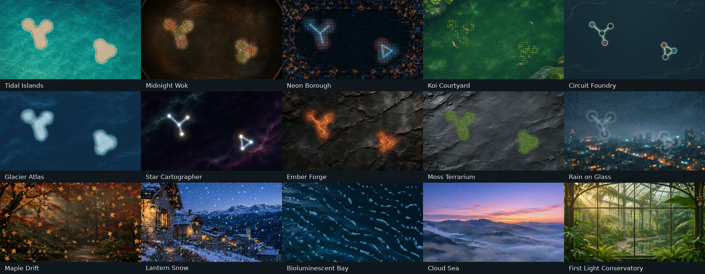

# Desktop Wallpapers

Desktop Wallpapers (`wallp`) is a Rust and wgpu live wallpaper engine for Windows, macOS, and Linux. It renders WGSL scenes and looping videos and still images on native desktop surfaces and pauses each display when the desktop backend detects fullscreen coverage.

## Get started

### Windows

1. Download **wallp.exe** and double-click it. [Latest release](https://github.com/Hike-12/Codex_1-Desktop-Wallpapers/releases/latest)
2. Maple Drift starts on your desktop and the gallery opens with all 15 wallpapers. Click any card to apply it.
3. Choose **+ Upload Video / Image** or drop a file onto the gallery to import and apply it. Supported formats are MP4, WebM, MKV, JPG, PNG, and WebP.

Close the gallery to keep the wallpaper running. Open it again from **Open Gallery** in the system tray or by double-clicking **wallp.exe**. The gallery controls pause, audio reactivity, rendering FPS, and whether wallp starts when you sign in. Use **Quit** in the tray to stop the wallpaper.

Keep the executable somewhere permanent before enabling **Start with OS**. The ZIP is an alternate download and contains the same executable. Downloaded Windows builds are unsigned.

### macOS and Linux

| Platform | Package | Desktop requirements |
| --- | --- | --- |
| macOS Apple Silicon or Intel | `wallp-macos-arm64.tar.gz` or `wallp-macos-x86_64.tar.gz` | A logged-in macOS desktop. The executable is not Developer ID notarized. |
| Linux x86-64 | `wallp-linux-x86_64.tar.gz` | An EWMH X11 desktop or a Wayland compositor with `zwlr_layer_shell_v1`. The build uses system graphics libraries and libpulse. |

Unpack the executable and run `./wallp`. The built-in collection is installed automatically and Maple Drift is the default. Pass a WGSL file, video, or pack folder as an argument to choose a scene at launch. Gallery controls and uploads are available on Windows.

## Wallpaper collection

[](wallpapers/preview.jpg)

### Interactive collection

| Pack | What the icon layout changes |
| --- | --- |
| [Tidal Islands](wallpapers/tidal-islands) | Sandbars join into beaches. Move a cluster and the sea fills the old shoreline |
| [Midnight Wok](wallpapers/midnight-wok) | Shortcuts become ingredients that sizzle together under drifting steam |
| [Neon Borough](wallpapers/neon-borough) | Neighborhoods light up, and traffic travels along roads between shortcuts |
| [Koi Courtyard](wallpapers/koi-courtyard) | Lily pads grow in clusters and koi steer around the beds |
| [Circuit Foundry](wallpapers/circuit-foundry) | Chip sockets connect via copper traces with traveling pulses |
| [Glacier Atlas](wallpapers/glacier-atlas) | Ice floes meet in blue fissures and thaw after you move the icons |
| [Star Cartographer](wallpapers/star-cartographer) | Shortcuts become stars linked into constellations |
| [Ember Forge](wallpapers/ember-forge) | Hot spots connect through molten channels and cool where shortcuts leave |
| [Moss Terrarium](wallpapers/moss-terrarium) | Moss and small leaves form connected gardens on damp slate |
| [Rain on Glass](wallpapers/rain-on-glass) | Water bends around the icons and runs along channels between them |

### Ambient wallpapers

| Pack | Animation |
| --- | --- |
| [Maple Drift](wallpapers/maple-drift) | Autumn leaves tumble at different depths, with a gust near the cursor |
| [Lantern Snow](wallpapers/lantern-snow) | Snow drifts through an alpine village and picks up warm lantern light |
| [Bioluminescent Bay](wallpapers/bioluminescent-bay) | Blue light follows breaking waves and gathers beneath the cursor |
| [Cloud Sea](wallpapers/cloud-sea) | Cloud banks roll between mountain ridges in shifting dawn light |
| [First Light Conservatory](wallpapers/first-light-conservatory) | Water beads run down glass while ferns sway and morning light shifts |

Windows reads Explorer's icon positions for the interactive packs. macOS and Linux use an animated demonstration layout. If Windows auto-arranges your icons, turn off **View → Auto arrange icons** in Explorer's desktop menu to place them freely. Ambient scenes animate on each supported platform. Cursor effects use pointer input where the desktop provides it. All 15 scenes render at the output resolution and ship with 3840×2160 textures upscaled from original generated artwork.

## Wallpaper packs

Put a `manifest.toml` and the referenced asset in one folder. The manifest accepts one asset field. Use paths relative to the pack directory.

**WGSL**

```toml
name = "Nebula"
shader = "nebula.wgsl"
```

Use `vs_main` and `fs_main` as entry points. The uniform buffer is at group 0, binding 0. Its first 16 bytes contain pixel resolution, animation time in seconds, and padding. For cursor and playback bands, copy the layout from the [built-in WGSL scene](core-engine/src/default.wgsl).

Add an optional `artwork = "background.jpg"` to bind a JPEG, PNG, or WebP as a shader texture. With artwork present, `desktop_icons = true` enables the animated icon field. See the [texture bindings](ARCHITECTURE.md#textured-shader-packs-and-desktop-icons) and the two pack shaders for examples.

**Video**

```toml
name = "Ocean"
video = "ocean.mp4"
```

MP4, WebM, and MKV loop silently and fill the display with a centered crop. Playback is capped at 1280×720 and 30 decoded frames per second. Release builds bundle the decoder.

For hand-authored Windows packs, choose **Open wallpapers folder** and then **Refresh wallpapers** in the tray after adding the pack. A failed live selection leaves the current scene active. For scripts, `wallp set <file-or-pack>` continues to switch the running Windows wallpaper.

## Playback and power

- `--audio` enables opt-in system playback capture for reactive shaders. Linux uses a PulseAudio-compatible output monitor. macOS uses Core Audio taps and needs a supported macOS version and System Audio Recording permission. [Apple Core Audio tap documentation](https://developer.apple.com/documentation/coreaudio/capturing-system-audio-with-core-audio-taps)
- `--battery-saver` pauses the scene while the machine reports battery power. Video decoding also stops when every output pauses and resumes from the last playback position.
- Wayland supplies a neutral cursor value. Fullscreen detection uses compositor toplevel information where available, with compositor frame pacing otherwise.

## Build and verify

Use stable Rust with Cargo. On Ubuntu, install the desktop build dependencies with:

```sh
sudo apt-get install libpulse-dev libwayland-dev libxkbcommon-dev libx11-dev pkg-config
```

```sh
cargo build --release --locked --bin wallp
cargo run --locked --bin wallp -- path/to/wallpaper
cargo test --workspace --locked
```

The workspace separates the shared renderer from the Explorer, AppKit, X11, and Wayland backends. [CI](https://github.com/Hike-12/Codex_1-Desktop-Wallpapers/actions/workflows/ci.yml) checks Windows, macOS, and Linux.

For the code map, native window lifecycles, rendering and playback flows, and release process, see the [architecture guide](ARCHITECTURE.md).

Windows desktop tests used Explorer. Linux desktop tests used X11/Openbox and headless Sway. macOS build checks cover Apple Silicon and Intel. Native Finder placement, audio consent, and physical battery transitions still need live verification.

### Fullscreen pause measurement

One Windows 11 debug run used a single 1536×960 display on AC power with system audio enabled. The test used the built-in WGSL scene.

| Process metric | Rendering | Fullscreen paused |
| --- | ---: | ---: |
| CPU share | 1.17% | 0.014% |
| Busiest GPU engine, average | 11.88% | 0% sampled |
| Working set | 274.5 MiB | 274.5 MiB |

### Bundled video tools

Release builds include FFmpeg and ffprobe under the LGPL. The tools run as separate processes. Developers building from source can use FFmpeg on PATH or embed their own binaries with `WALLP_FFMPEG_DIR` at build time. The same environment variable can point at replacement tools at runtime. [FFmpeg source and license notice](scripts/ffmpeg-notice.txt) · [Build recipe](scripts/build-ffmpeg.sh)
